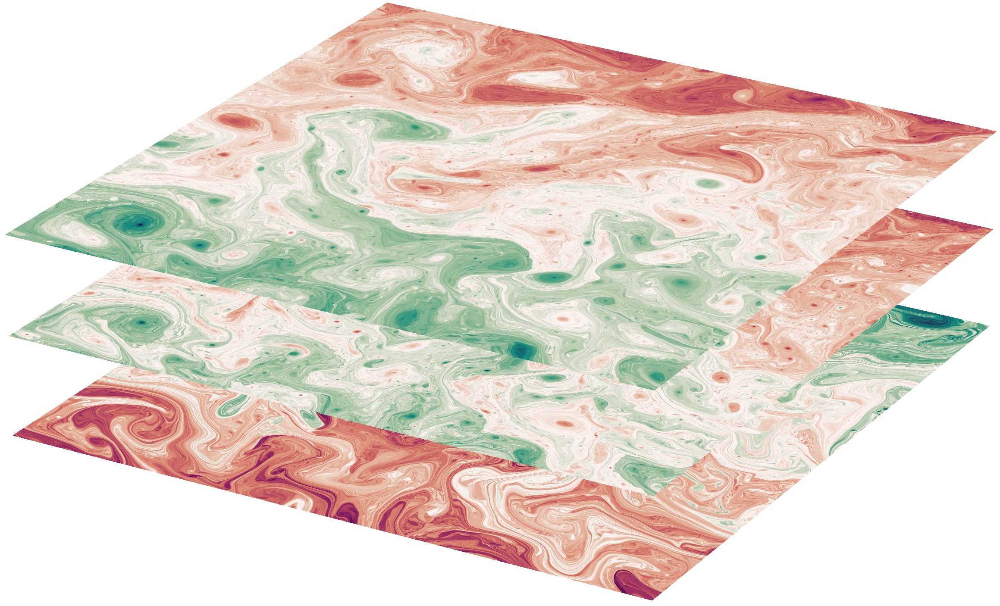

# jaxqg

[](https://github.com/mtbrolly/jaxqg/actions/workflows/ci.yml)
[](LICENSE)



`jaxqg` is a differentiable, GPU-compatible pseudospectral solver for multi-layer quasi-geostrophic turbulence. The core numerics are largely based on [PyQG](https://github.com/pyqg/pyqg) and equivalence between the two is tested in CI, but it is neither a direct nor a complete port.

This code exists primarily to serve as a test case for methods development. The model accepts parameterisations in a very flexible way -- see the `param_func` and `aux_func` arguments to `Model`.

## Installation

Requires Python 3.10 or newer. From a checkout:

```bash
python -m pip install -e '.[dev]'       # package + test tools
python -m pip install -e '.[notebooks]'  # + matplotlib/Jupyter for the notebooks
```

Install the JAX backend matching your hardware, then select it *before importing* `jaxqg` (CPU/CUDA default to float64; `JAX_ENABLE_X64=0` forces float32, and is the default on Metal):

```bash
python -m pip install -U "jax[cuda13]"  # NVIDIA CUDA (Linux, CUDA 13 driver)
python -m pip install jax-mps           # Apple Silicon Metal/MPS

JAX_PLATFORMS=cpu|gpu|mps python your_script.py
```

## Minimal Example

```python
from jaxqg import create_two_layer_model, define_state, gaussian_random_field

model = create_two_layer_model()
qh0 = gaussian_random_field(model, 1e-23 * model.grid.wv**-4, seed=1)
qh0 = qh0.at[:, model.grid.wv2_nd < 8].set(0.0)  # remove large scales
state = define_state(model, qh0)
integrate = model.generate_integration_fn(
    n_steps=20, sample_rate=10, sample_fields=("qh",))
trajectory = integrate(state)
print(trajectory.qh.shape)  # (2 samples, 2 layers, n_y, n_x//2 + 1)
```

## API

- **Model construction**: `Model`, `State`, `Grid`,
  `create_two_layer_model`, `create_barotropic_model`, `define_state`
- **Dynamics**: `QGDynamics`, `SpectralFilter`, `AB3`, `Euler`,
  `SimulationStats`
- **Multi-device**: `MultiGPUConfig`, `MultiGPUSimulator`,
  `run_simulation`, `setup_multi_gpu`, `select_devices`,
  `shard_state_across_layers`
- **Diagnostics**: `EKE`, `APE`, `EQ`, `cfl`,
  `isotropic_EKE_spectrum`, `isotropic_EQ_spectrum`,
  `height_averaged_isotropic_EKE_spectrum`,
  `height_averaged_isotropic_EQ_spectrum`, `vertical_modes`,
  `eddy_turnover_time`, `modal_amplitude`
- **Plotting**: `plot_isotropic_energy_spectrum` (requires the
  `notebooks` extra / matplotlib)
- **Utilities**: `gaussian_random_field`, `selected_platform`,
  `x64_enabled`, `FLOAT`, `COMPLEX` (backend precision-policy
  dtypes)

`notebooks/quickstart.ipynb` is the end-to-end walkthrough (build model →
initialise PV field → integrate → compute energies → plot isotropic spectrum). `notebooks/ad_timing_demo.ipynb` demonstrates and times automatic differentiation of a model trajectory.
